# Web-Slinger: Night Patrol

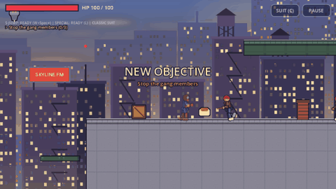

A side-scrolling superhero action game built in **Godot 4.7 (GDScript, Compatibility renderer)**. Traversal plays like the classic Java-era *Spider-Man 3* mobile side-scroller. The fights take their cues from modern 2.5D mobile fighters: block and parry, heavy attacks, dash strikes, a 3-bar power meter with cinematic specials, and a camera that pushes in when a fight starts. There's a five-chapter story, a replayable **Night Arena** (Gauntlet tiers, endless Survival and a Daily Challenge), chapter **ranks and stars**, and a token **shop** for upgrades and suits.

> **Unofficial fan project.** Spider-Man, the Spider-Verse variants, the Green Goblin and Mary Jane are Marvel characters (the *Spider-Verse* films are Sony Pictures Animation). This non-commercial project is not affiliated with or endorsed by Marvel, Sony or any publisher. All artwork, animation, music, sound effects, level design and dialogue are original and are generated by the scripts in [`tools/`](tools/). No assets were taken from any existing game.

**Play in the browser:** https://tusharrr5.github.io/Spiderman_Game/ (desktop keyboard; it loads about 70 MB on first visit).

| | |
|---|---|
| 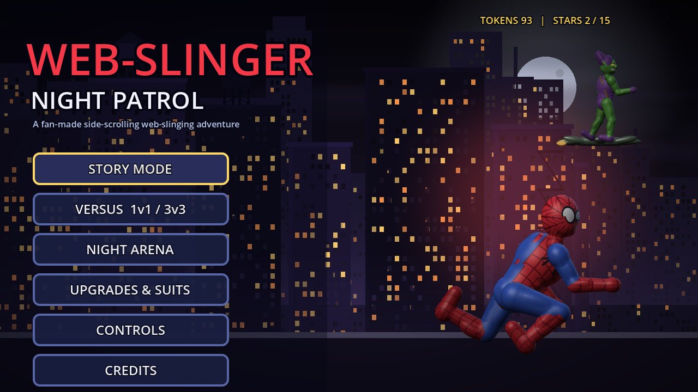 | 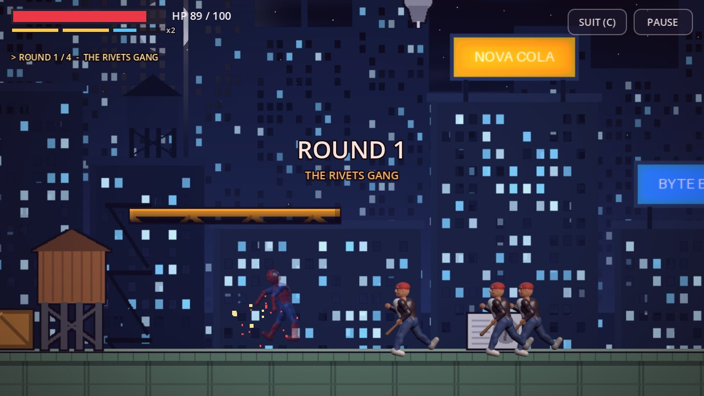 |
| 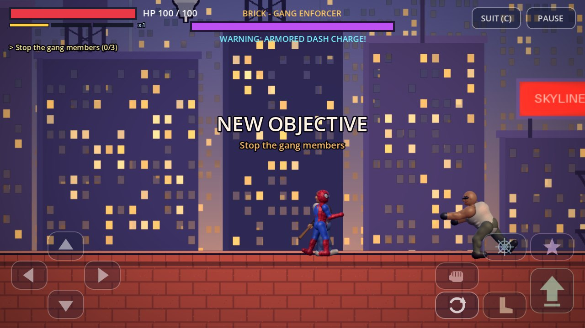 | 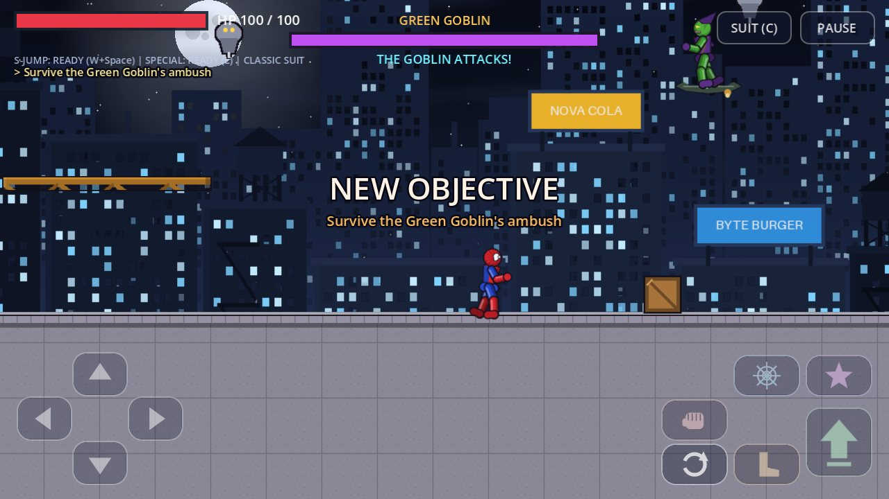 |
| 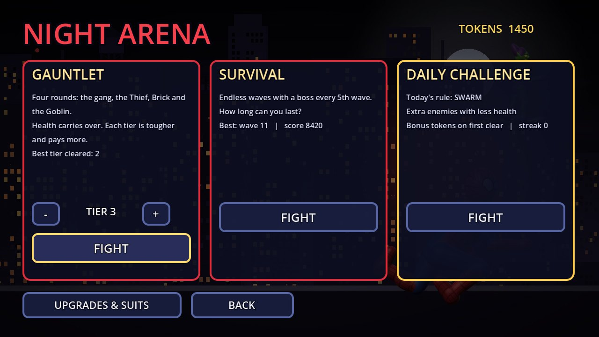 | 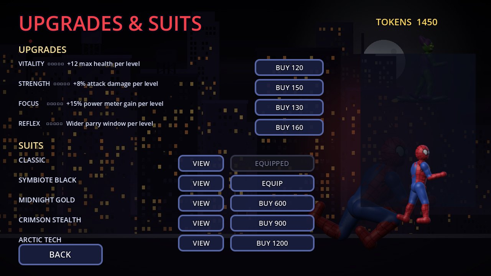 |
| 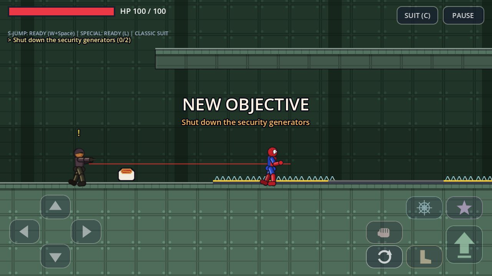 | 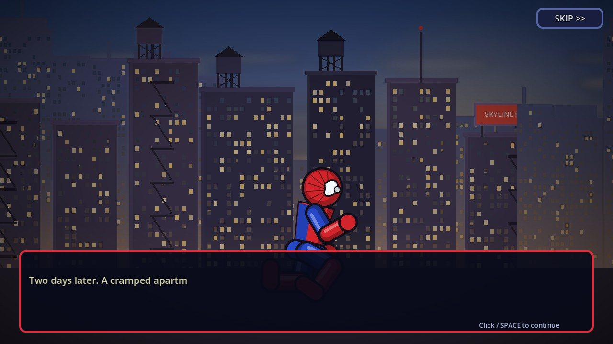 |

## The campaign

| # | Chapter | Highlights |
|---|---|---|
| 1 | **Street-Level Trouble** | Tutorial rooftops at dusk. Covers running, jumping, wall climbing, fire escapes, your first web swing, crate throws, the Rivets gang, and **Brick**, the gang enforcer (dash charge, shockwave slam, dazed windows). |
| 2 | **The Rooftop Thief Chase** | A sunset chase. The thief runs a scripted rooftop route and taunts you if you fall behind. Also has gunners with laser sights, a construction site with a crane lift, and a cornered-thief duel (energy shots, dash kicks, exhausted windows). |
| 3 | **Green Goblin Ambush** | A night-time chemical yard with bomb drones and electrified floors. The Goblin's ambush is a fair, learnable fight that ends in a **deliberate story defeat** at 55% of his health, so it is never an impossible grind. |
| 4 | **Rescue Mission** | Inside the Goblin's facility. Covers shock corridors (crawl the ceiling over them), generator-locked energy gates, the cell-block guards, and breaking MJ's cage. Then a **timed escape** with MJ following you. |
| 5 | **The Final Goblin Showdown** | A storm-swept rooftop in rain and lightning. A **three-phase** Goblin fight: bomb tosses and crash-landing swoops, then razor bats and drone summons, then an enraged bomb rain. |

Each chapter has an illustrated intro and outro, in-level dialogue, objectives, checkpoints and its own music. Dying restarts **the current chapter** from its last checkpoint, or from the start if you choose. Completed chapters stay unlocked, and progress is saved automatically (`user://savegame.cfg`). Levels 6–20 appear in level select as locked future arcs (Scorpion, Doctor Octopus, Rhino, Kraven, Venom finale). They are not playable yet.

## Versus mode (1 VS 1 and 3 VS 3)

| | |
|---|---|
| 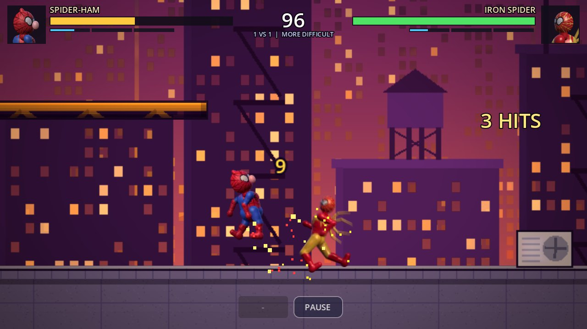 | 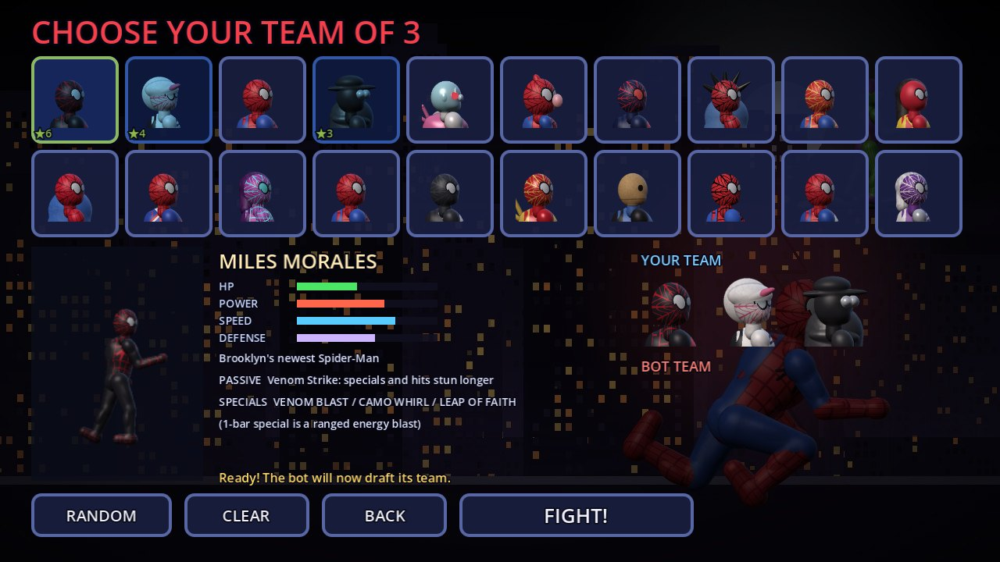 |

The fights take cues from fan-favourite mobile fighters like *Stickman Dragon Fight* (team battles, energy blasts, charging up) and *Marvel Contest of Champions* (block, parry, specials, close camera).

- **1 VS 1**: pick a fighter. The bot drafts its own fighter from the same roster.
- **3 VS 3 (team elimination)**: pick three. The bot picks three. Fighters come in one at a time, and the first team to knock out all three opponents wins. Health and power stay with each fighter. Press **TAG** (`C`) to swap in a teammate, who dashes in with a strike (10 s cooldown). Bots on Difficult and above tag out when hurt.
- **CPU VS CPU**: watch two bot teams fight.
- **Difficulty**: Easy, Moderate, Difficult, More Difficult. This changes the bot's reaction time, how often it blocks and parries, its aggression, combo length (2 to 5 hits), use of specials, its damage and its fighter level. Measured against a player who just stands there for 12 s, the bot deals roughly 60 / 130 / 150-230 / 290-400 damage on the four levels (it varies with crits and buffs). Fighters have about 180 HP.
- **Rules**: 99-second bouts. On time-out, the fighter with less health loses the bout. KOs trigger slow-motion.
- **The roster**: 20 Spider-Verse-inspired variants, each with its own art, stats (HP, power, speed, defense), a passive and three named specials. Six of them fire a ranged energy blast as their 1-bar special.

  Miles Morales, Spider-Gwen, Peter B. Parker, Spider-Man Noir, Peni & SP//dr, Spider-Ham, Spider-Man 2099, Spider-Punk, Spider-Man India, Spider-Woman, Scarlet Spider, Spider-UK, Spider-Byte, Peter Parker (classic), Symbiote Spider-Man, Iron Spider, Bombastic Bag-Man, Spider-Man '67, Advanced Suit, Cyborg Spider-Woman.
- **Contest-of-Champions-style fighting**:
  - **5-hit chain**: jab, cross, hook, roundhouse, finisher, each with its own animation. Landing the 5th hit grants **FURY**.
  - **Buffs and debuffs**, shown as icons with timers under the health bar: Fury, Armor Up, Precision, Power Gain and Regeneration; Bleed, Shock (also drains power), Poison (blocks healing), Armor Break, Weakness and Stun. They stack up to 3 times.
  - **Signature abilities**: every fighter has a signature debuff (inflicted by heavies and the last hit of SP2) and a signature buff (gained when casting SP1). SP3's final blow breaks armour.
  - **Classes**: Science, Mystic, Cosmic, Tech and Skill. Each beats the next (Science > Mystic > Cosmic > Tech > Skill > Science) for +12% damage, shown as a green or red arrow by the class badge.
  - **Boosts** (pre-fight items): Attack, Defense, Power, Crit and Health. Pick up to 2 on the fighter select screen; they are used up when the fight starts. Earn them from wins and daily rewards, or buy them in the shop.
  - **Team synergies** (3v3): Into the Spider-Verse, The Peter Parkers, Spider-Gang, Spider-Society and class bonds.
  - **Fighter levels**: each fighter earns XP and levels up to LV 10 (+2% health and attack per level).
  - **Intros and victory poses**: fighters land into the arena at the start of each round and pose after a KO. A round won without taking damage is a **PERFECT!**
- **Extras**:
  - **Focus charge**: hold `L` with an empty meter to power up while exposed.
  - **Passives**: healing factor, crits, armour, lifesteal, focus, haymaker, evasion and web mastery.
  - **Records and rewards**: win/loss and streak records, and per-fighter win stars on the select screen. Wins pay tokens (more on harder levels and in 3v3), and there's a rematch button.

## Replay value

- **Chapter ranks.** Every chapter and arena run is scored on time, damage taken, best combo, parries and specials. You get a rank from D to S, up to 3 stars and tokens. Level select shows your best rank and stars.
- **Night Arena** (unlocked after Chapter 1):
  - **Gauntlet**: four rounds per tier (the gang, the Thief, Brick, the Goblin). Health carries over between rounds. Every tier is harder and pays more.
  - **Survival**: endless waves, with a boss every 5th wave. Your best wave and score are saved.
  - **Daily Challenge**: a date-seeded lineup with one rule twist (Glass Cannon, Power Surge, Iron Guard or Swarm). The first clear each day pays a streak bonus.
- **Shop.** Spend tokens on Vitality, Strength, Focus (meter gain) and Reflex (parry window), five levels each, and on versus boosts. There are also three extra suits (Midnight Gold, Crimson Stealth, Arctic Tech) alongside Classic and Symbiote Black.
- **Daily reward.** Opening the game each day pays tokens on a 7-day track (days 3, 5 and 7 add boosts). Keep the streak going for bigger rewards.
- **Challenges.** 15 goals (win streaks, MORE DIFFICULT wins, parries, five-hit combos, level-3 specials, debuffs, flawless rounds, winning with 10 fighters, a level-10 fighter) that pay tokens when completed.

## Controls

Every key can be changed: **CONTROLS & KEYS** on the title screen, or **PAUSE > KEYS** in game. Each action has two key slots. Click a slot and press the new key (`Esc` cancels, `Backspace` clears it). Taking a key that another action uses swaps the two, and **RESET DEFAULTS** brings back the keys below. Your keys are saved, and in-game hints show your own keys.

| Action | Default keys | Touch |
|---|---|---|
| Move | `A` / `D` or arrow keys | ◀ ▶ |
| Jump (variable height) / Super jump | `Space` / `W` + `Space` | ⬆ / hold ▲ + ⬆ |
| Climb walls / crawl ceilings | run into a wall or hold `W`; jump into a ceiling while holding `W`; `S` drops | ▲ / ▼ |
| Punch combo (story: jab, cross, finisher; versus: 5 hits) | tap `J` (or mix in `H`) | fist |
| Heavy (breaks guards) | hold `J` | hold fist |
| Block / **parry** (block just before a hit lands: the attacker is stunned) | hold `S` | hold ▼ |
| Kick | `H` | boot |
| Web shot / web swing | `K` (in the air near an anchor = swing; `Space` releases) | web |
| Specials (power meter): 1 / 2 / 3 bars | `L` / `W`+`L` / `S`+`L` | star / ▲+star / ▼+star |
| Throw crate | `L` next to a crate | star |
| Dodge roll / dash strike | `Shift` / `Shift` then `J` | ↻ |
| Focus charge (empty meter) | hold `L` | hold star |
| Versus 3v3: tag a teammate | `C` | TAG |
| Suit swap / pause | `C` / `Esc` | SUIT / PAUSE |

Landing hits, blocking, parrying and taking hits fill the power meter. Later chapters' thugs block light attacks, so use heavies, finishers and specials to break their guard. The pause menu turns the on-screen pads on or off and switches post-processing **FX: HIGH/LOW** for slower devices. Press `F3` to show the input diagnostics overlay.

## Running

Requires Godot **4.7.x** (standard build).

```bash
# play
/path/to/Godot.app/Contents/MacOS/Godot --path .

# open in the editor
/path/to/Godot.app/Contents/MacOS/Godot --editor --path .
```

> **Running inside the editor's Game tab:** if the Game tab toolbar is in **2D/3D select** mode, or **Suspend** is on, Godot blocks all game input before it reaches the game. Select the gamepad **Input** button (or turn off *Embed Game*) and the controls work. The in-game diagnostics overlay (`F3`) reports this as `INPUT_SINGLETON_BLOCKED`.

## Graphics

All characters are **pre-rendered 3D-look sprites** generated by `tools/art/vol_renderer.py` and `vol_chars.py`:
- Each body part is a tapered capsule or ellipsoid (muscles included), rendered as a 3D height field. Parts are smooth-blended, then lit with a key light, hemisphere ambient, rim light, specular and screen-space ambient occlusion.
- Suit patterns (web seams, emblem, fabric, scales) wrap around the 3D surface. The camera fakes a 3/4 angle.
- Frames are rendered at 4 texels per game pixel, with in-between frames and motion blur on strikes.

In game, a full-screen grade adds bloom, filmic contrast, split toning and a vignette. A camera director pushes in on fights and adds letterbox bars for the 3-bar special.

## Tests

```bash
# full automated suite: prototype input regression, every campaign chapter, combat + arena/economy, versus
Godot --headless --fixed-fps 60 --path . -s res://tests/headless_test_runner.gd

# parse/compile every script and scene
Godot --headless --path . -s res://tests/compile_check.gd
```

The campaign suite loads every chapter and checks:
- spawn, checkpoint and enemy placement against real collision;
- that a real `J` keypress damages a thug;
- the Thief running his entire chase route under his own physics;
- the Chapter 3 scripted ambush;
- the Chapter 4 ceiling crawl, generators and gates, guards, cage, MJ following you, and the escape;
- the Chapter 5 phase transitions and drone summons;
- death, retry-at-checkpoint (always the current chapter), save/load, unlocking, and locked future chapters.

The versus suite covers:
- all 20 fighters loading and spawning;
- bots that fight, and that block and parry more at higher difficulty;
- damage scaling across the four levels;
- 1v1 wins, and 3v3 elimination with real C-key tags (win and loss);
- the timer, focus charge, blast specials and CPU VS CPU;
- the Story/Versus title menu, the setup screen and fighter select with the bot's draft;
- key rebinding: Q for web shot, swapping on conflicts, saving, a real rebound key press, the settings screen and reset;
- the 5-hit chain into Fury, a heavy inflicting the signature debuff and Bleed ticking damage, SP1's buff and the HUD icons;
- the class triangle, boosts being used up and applied, synergies, fighter XP and levels, challenges, the daily reward and the boost shop.

The combat & replay suite drives real key events. It checks:
- block chip damage and a timed parry;
- hold-J heavy against a guarding thug, and the guard break;
- SP2 (W+L) and the cinematic multi-hit SP3 (S+L);
- scoring ranks, tokens, upgrades and suits, including save/load;
- a full Gauntlet tier and a Survival run.

The tests use a scratch save file and never touch your progress.

## Web build (GitHub Pages)

The `Web` preset uses the Compatibility renderer and `thread_support=false`, so the build runs on standard static hosting with no special COOP/COEP headers. It exports with relative paths only.

```bash
mkdir -p build/web
Godot --headless --path . --export-release "Web" build/web/index.html
python3 -m http.server 8000 --directory build/web    # then open http://localhost:8000
```

The live build is served from the `gh-pages` branch at https://tusharrr5.github.io/Spiderman_Game/. To update it, export again and replace the contents of the `gh-pages` branch with `build/web/` plus an empty `.nojekyll` file. Because the export uses only relative paths, hosting under a repository subpath works.

## Android

The `Android` preset is configured as a landscape `arm64-v8a` build with package `com.nightslinger.prototype`. You need:
- the matching Godot 4.7.2 export templates;
- OpenJDK 17;
- Android SDK command-line tools with `platforms;android-34` and `build-tools;34.0.0`;
- the SDK path and a debug keystore set in *Editor Settings → Export → Android*.

```bash
mkdir -p build/android
Godot --headless --path . --export-debug "Android" build/android/web_slinger_debug.apk
adb install -r build/android/web_slinger_debug.apk
```

For a release APK, create your own keystore (`keytool -genkeypair ...`), set it in the Android preset's release signing fields, and run `--export-release`. **Never commit keystores or passwords.** `export_credentials.cfg` is already git-ignored.

## Architecture

```
scripts/core/       GameState (saves, unlocks, routing, tokens/upgrades/suits/ranks, boosts/levels/daily/challenges), KeyBindings, Audio, Fx, SpriteAnimator, CombatCamera, PostFX, Scoring
scripts/player/     PlayerController - explicit state machine (idle, run, jump, fall, wall climb, ceiling crawl, web swing, attack, hurt, dodge, block, defeated)
                    + fighting layer: guard/parry hook, heavy, dash strike, power meter, multi-hit specials, run stats
scripts/combat/     Health / Hitbox (one hit per target per swing) / Hurtbox components, web & enemy projectiles, throwable crates
scripts/enemies/    EnemyBase -> NormalEnemy (thug), GunnerEnemy, DroneEnemy;  BossBase -> ThiefBoss, GoblinBoss;  PrototypeBoss (Brick)
scripts/versus/     VersusLevel (1v1 / 3v3 / CPU, tag, timer, KO flow, boosts, synergies, results), FighterAI (bot brain, 4 difficulty levels), FightEffects (buffs/debuffs)
scripts/levels/     CampaignLevel (objectives, checkpoints, story events, weather, results), ArenaLevel (gauntlet/survival/daily), LevelBuilder
scripts/data/       LevelRegistry (chapters), StoryData, SpiderRoster (20 versus fighters), SpriteDB (generated manifest)
scripts/ui/         HUD + multi-touch pads, FightHUD, VersusHUD, KeyBindPanel (rebinding), results card, dialogue, diagnostics, menus (title, level select, arena hub, shop, story, credits)
tools/art/          vol_renderer/vol_chars/vol_build: pre-rendered 3D character pipeline; env/prop/portrait generators (python3 + Pillow + numpy)
tools/audio/        Procedural music & SFX synthesizer (python3 + numpy)
tools/capture/      Screenshot capture and README GIF recording via Godot's movie writer
tests/              Headless launcher + prototype, campaign and combat/replay suites, compile check
```

Chapters are **data** (`LevelRegistry`): geometry, props, anchors, enemies, bosses, hazards, gates, checkpoints, triggers, objectives and story keys. Adding Levels 6–20 means adding data, plus new enemy or boss classes where a villain needs unique behaviour. The player, combat and HUD code stay untouched.

The view is a 640×360 virtual resolution (`canvas_items` stretch, `expand` aspect) with a 1.25× gameplay camera. Art is authored at 2× and displayed at 0.5 scale, so it maps 1:1 onto a 1280×720 window.

## Regenerating assets

```bash
python3 tools/art/build_all.py        # characters, backgrounds, tiles, props, icons, portraits, story panels, title art
python3 tools/art/build_all.py --chars-only    # just the character atlases (~15 s, parallel)
python3 tools/audio/build_audio.py    # music loops and sound effects
Godot --headless --path . --import    # re-import changed files
```

## Known limitations

- Characters are procedural pre-rendered 3D-look sprites, not motion-captured 3D models like big-budget mobile fighters. Backgrounds are still painted 2D layers. Every sprite comes from `tools/art`, so an artist could replace the atlas PNGs while keeping the same frame grid (see `scripts/data/sprite_db.gd`).
- Music and SFX are simple synthesized chiptune-style loops.
- Real mobile touch and Android packaging have not been tested on a device.
- Ceiling crawling needs flat horizontal ceilings.

## Licences

- Code, art, audio and level/story content in this repository are original work for this fan project.
- Godot Engine is MIT-licensed ([godotengine.org/license](https://godotengine.org/license)).
- Billboard text uses Pillow's built-in default font (Aileron, released under CC0).
