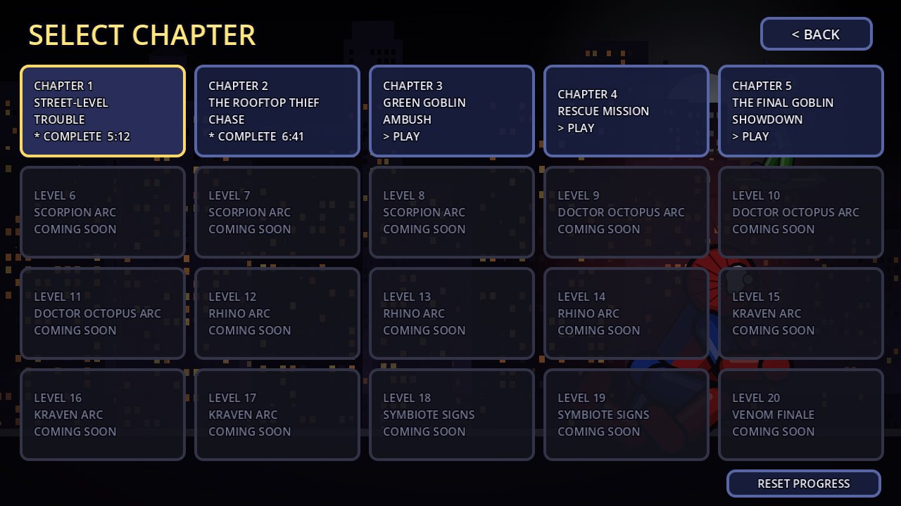

# Web-Slinger: Night Patrol


A side-scrolling superhero action-platformer built in **Godot 4.7 (GDScript, Compatibility renderer)**. It plays like the classic Java-era *Spider-Man 3* mobile side-scroller, but every system is rebuilt for modern hardware: smooth animation, wall and ceiling crawling, web swinging, combo combat, distinct boss fights and a five-chapter story campaign.

> **Unofficial fan project.** Spider-Man, the Green Goblin and Mary Jane are Marvel characters. This non-commercial project is not affiliated with or endorsed by Marvel, Sony or any publisher. All artwork, animation, music, sound effects, level design and dialogue are original and are generated by the scripts in [`tools/`](tools/). No assets were taken from any existing game.

**Play in the browser:** not published yet. See [Web build](#web-build-github-pages).

| | |
|---|---|
|  |  |
|  |  |
|  |  |

## The campaign

| # | Chapter | Highlights |
|---|---|---|
| 1 | **Street-Level Trouble** | Tutorial rooftops at dusk. Covers running, jumping, wall climbing, fire escapes, your first web swing, crate throws, the Rivets gang, and **Brick**, the gang enforcer (dash charge, shockwave slam, dazed windows). |
| 2 | **The Rooftop Thief Chase** | A sunset chase. The thief runs a scripted rooftop route and taunts you if you fall behind. Also has gunners with laser sights, a construction site with a crane lift, and a cornered-thief duel (energy shots, dash kicks, exhausted windows). |
| 3 | **Green Goblin Ambush** | A night-time chemical yard with bomb drones and electrified floors. The Goblin's ambush is a fair, learnable fight that ends in a **deliberate story defeat** at 55% of his health, so it is never an impossible grind. |
| 4 | **Rescue Mission** | Inside the Goblin's facility. Covers shock corridors (crawl the ceiling over them), generator-locked energy gates, the cell-block guards, and breaking MJ's cage. Then a **timed escape** with MJ following you. |
| 5 | **The Final Goblin Showdown** | A storm-swept rooftop in rain and lightning. A **three-phase** Goblin fight: bomb tosses and crash-landing swoops, then razor bats and drone summons, then an enraged bomb rain. |

Each chapter has an illustrated intro and outro, in-level dialogue, objectives, checkpoints and its own music. Dying restarts **the current chapter** from its last checkpoint, or from the start if you choose. Completed chapters stay unlocked, and progress is saved automatically (`user://savegame.cfg`). Levels 6–20 appear in level select as locked future arcs (Scorpion, Doctor Octopus, Rhino, Kraven, Venom finale). They are not playable yet.

## Controls

| Action | Keyboard | Touch |
|---|---|---|
| Move | `A` / `D` or arrow keys | ◀ ▶ |
| Jump (variable height) / Super jump | `Space` / `W` + `Space` | ⬆ / hold ▲ + ⬆ |
| Climb walls / crawl ceilings | run into a wall or hold `W`; jump into a ceiling while holding `W`; `S` drops | ▲ / ▼ |
| Punch combo (jab, cross, finisher) | `J` `J` `J` (or `J` `J` `H`) | fist |
| Kick | `H` | boot |
| Web shot / web swing | `K` (in the air near an anchor = swing; `Space` releases) | web |
| Throw crate / web slam | `L` | star |
| Dodge roll (brief invulnerability) | `Shift` | ↻ |
| Suit swap / pause | `C` / `Esc` | SUIT / PAUSE |

The on-screen pads can be turned on or off in the pause menu. Press `F3` to show the input diagnostics overlay.

## Running

Requires Godot **4.7.x** (standard build).

```bash
# play
/path/to/Godot.app/Contents/MacOS/Godot --path .

# open in the editor
/path/to/Godot.app/Contents/MacOS/Godot --editor --path .
```

> **Running inside the editor's Game tab:** if the Game tab toolbar is in **2D/3D select** mode, or **Suspend** is on, Godot blocks all game input before it reaches the game. Select the gamepad **Input** button (or turn off *Embed Game*) and the controls work. The in-game diagnostics overlay (`F3`) reports this as `INPUT_SINGLETON_BLOCKED`.

## Tests

```bash
# full automated suite: prototype input regression + every campaign chapter (~1 minute)
Godot --headless --fixed-fps 60 --path . -s res://tests/headless_test_runner.gd

# parse/compile every script and scene
Godot --headless --path . -s res://tests/compile_check.gd
```

The campaign suite loads every chapter and checks:
- spawn, checkpoint and enemy placement against real collision;
- that a real `J` keypress damages a thug;
- the Thief running his entire chase route under his own physics;
- the Chapter 3 scripted ambush;
- the Chapter 4 ceiling crawl, generators and gates, guards, cage, MJ following you, and the escape;
- the Chapter 5 phase transitions and drone summons;
- death, retry-at-checkpoint (always the current chapter), save/load, unlocking, and locked future chapters.

The tests use a scratch save file and never touch your progress.

## Web build (GitHub Pages)

The `Web` preset uses the Compatibility renderer and `thread_support=false`, so the build runs on standard static hosting with no special COOP/COEP headers. It exports with relative paths only.

```bash
mkdir -p build/web
Godot --headless --path . --export-release "Web" build/web/index.html
python3 -m http.server 8000 --directory build/web    # then open http://localhost:8000
```

To publish, push `build/web/` to a `gh-pages` branch (or a `docs/` folder) and enable GitHub Pages. Because the export uses only relative paths, hosting under a repository subpath (`https://<user>.github.io/<repo>/`) works.

## Android

The `Android` preset is configured as a landscape `arm64-v8a` build with package `com.nightslinger.prototype`. You need:
- the matching Godot 4.7.2 export templates;
- OpenJDK 17;
- Android SDK command-line tools with `platforms;android-34` and `build-tools;34.0.0`;
- the SDK path and a debug keystore set in *Editor Settings → Export → Android*.

```bash
mkdir -p build/android
Godot --headless --path . --export-debug "Android" build/android/web_slinger_debug.apk
adb install -r build/android/web_slinger_debug.apk
```

For a release APK, create your own keystore (`keytool -genkeypair ...`), set it in the Android preset's release signing fields, and run `--export-release`. **Never commit keystores or passwords.** `export_credentials.cfg` is already git-ignored.

## Architecture

```
scripts/core/       GameState (saves, unlocks, checkpoints, routing), Audio (music/SFX), Fx (hit-stop, shake, flash, particles), SpriteAnimator
scripts/player/     PlayerController - explicit state machine (idle, run, jump, fall, wall climb, ceiling crawl, web swing, attack, hurt, dodge, defeated)
scripts/combat/     Health / Hitbox (one hit per target per swing) / Hurtbox components, web & enemy projectiles, throwable crates
scripts/enemies/    EnemyBase -> NormalEnemy (thug), GunnerEnemy, DroneEnemy;  BossBase -> ThiefBoss, GoblinBoss;  PrototypeBoss (Brick)
scripts/levels/     CampaignLevel (objectives, checkpoints, story events, weather), LevelBuilder, reusable level objects
scripts/data/       LevelRegistry (all chapter data), StoryData (script & character names), SpriteDB (generated sprite manifest)
scripts/ui/         HUD + multi-touch pads, dialogue box, input diagnostics overlay, menus (title, level select, story, credits)
tools/art/          Procedural character/background/prop/portrait generators (python3 + Pillow)
tools/audio/        Procedural music & SFX synthesizer (python3 + numpy)
tools/capture/      Screenshot capture and README GIF recording via Godot's movie writer
tests/              Headless launcher + prototype and campaign suites, compile check
```

Chapters are **data** (`LevelRegistry`): geometry, props, anchors, enemies, bosses, hazards, gates, checkpoints, triggers, objectives and story keys. Adding Levels 6–20 means adding data, plus new enemy or boss classes where a villain needs unique behaviour. The player, combat and HUD code stay untouched.

The view is a 640×360 virtual resolution (`canvas_items` stretch, `expand` aspect) with a 1.25× gameplay camera. Art is authored at 2× and displayed at 0.5 scale, so it maps 1:1 onto a 1280×720 window.

## Regenerating assets

```bash
python3 tools/art/build_all.py        # characters, backgrounds, tiles, props, icons, portraits, story panels, title art
python3 tools/audio/build_audio.py    # music loops and sound effects
Godot --headless --path . --import    # re-import changed files
```

## Known limitations

- The art is original procedural vector-style work: clean and cohesive, but not hand-painted. Every sprite comes from `tools/art`, so a commissioned artist could replace the PNG strips while keeping the same frame layout (see `scripts/data/sprite_db.gd`).
- Music and SFX are simple synthesized chiptune-style loops.
- Real mobile touch and Android packaging have not been tested on a device.
- Ceiling crawling needs flat horizontal ceilings.

## Licences

- Code, art, audio and level/story content in this repository are original work for this fan project.
- Godot Engine is MIT-licensed ([godotengine.org/license](https://godotengine.org/license)).
- Billboard text uses Pillow's built-in default font (Aileron, released under CC0).
